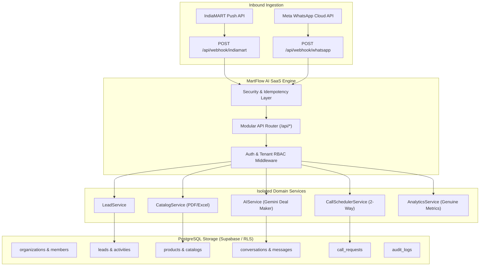

# 🚀 MartFlow AI — Production IndiaMART WhatsApp AI Sales SaaS

> **Autonomous Multi-Tenant B2B Sales & Deal Closing SaaS for Indian Manufacturers & Wholesalers.**  
> Grounded in real catalog specs with zero hallucinations, 2-way factory owner call booking, sub-10 second WhatsApp brochure dispatch, and multi-tenant PostgreSQL/Supabase architecture.

[](https://indiamart-ai-sales-closing.netlify.app)
[](https://github.com/shopshah5-eng/indiamart-whatsapp-ai-sales-agent)
[](https://github.com/shopshah5-eng/indiamart-whatsapp-ai-sales-agent)

---

## 🌟 Executive Summary

**MartFlow AI** transforms slow, manual marketplace inquiry follow-ups into an **Autonomous 24/7 AI Sales Representative** operating directly on WhatsApp for Indian factories and industrial suppliers:
1. **⚡ Sub-10s IndiaMART Engagement**: Ingests incoming buyer inquiries via official webhook, verifies identity, and dispatches the exact matching PDF brochure on WhatsApp in under 10 seconds.
2. **🎙️ Natural Voice Notes (On-Demand)**: Speaks conversational Hindi, Hinglish, and English encoded in 48kHz mono Opus OGG (`audio/ogg; codecs=opus`) strictly on-demand.
3. **📑 Multi-Format Catalog Knowledge**: Ingests PDF catalogs, Excel (`.xlsx`, `.xls`), and CSV files into structured, tenant-isolated product specifications with zero price hallucination.
4. **🤝 Two-Way Factory Owner Call Scheduling**: Coordinates between buyer request and factory owner via WhatsApp, parses natural language free-time slots, and dispatches 1-tap dial links.
5. **🏢 Multi-Tenant SaaS Isolation**: Built on PostgreSQL/Supabase with Row-Level Security (RLS) and strict tenant scoping (`organization_id` on all records).

---

## 🏗️ Architecture & Component Separation



---

## 🖥️ 10-Item Clean White SaaS Dashboard

The frontend interface follows the design principles of Linear, Stripe, and Vercel with a clean white palette, soft gray borders, navy/charcoal typography, and emerald/amber indicators:

1. **Dashboard** (`#dashboard`): Live connection badge, key performance indicators (Leads Today, Median Response Time, Qualified Leads, Confirmed Calls, Active SKUs), and pure zero-demo empty states.
2. **Leads** (`#leads`): Filterable, searchable lead table, status workflow (`new`, `processing`, `replied`, `qualified`, `awaiting_call`, `call_booked`, `converted`), agent assignment, and CSV export.
3. **Conversations** (`#conversations`): Two-pane WhatsApp live inbox, message timeline, composer, delivery status, and AI/Human takeover toggle.
4. **Product Catalog** (`#catalog`): Drag-and-drop multi-format uploader (PDF, XLSX, XLS, CSV) with automatic OCR and specification extraction into structured records.
5. **WhatsApp Setup** (`#whatsapp`): Dual-provider adapter: Official Meta Cloud API (WABA ID, Phone Number ID, Permanent System User Token) and Baileys Multi-Device pairing.
6. **Call Scheduler** (`#calls`): 2-way call booking log, proposed vs confirmed time slots, owner alert status, and 1-tap WhatsApp dial links.
7. **Analytics** (`#analytics`): Calculated strictly from real database records (zero synthetic data).
8. **Team & Roles** (`#team`): Workspace members list with RBAC roles (`owner`, `admin`, `sales_manager`, `sales_agent`) and invitations.
9. **Settings** (`#settings`): Company profile, IndiaMART webhook URL with 1-click copy, and AI deal-making rules.
10. **Billing** (`#billing`): Subscription plans (Starter, Growth, Enterprise), usage counters, and Razorpay payment integration readiness.

---

## 🔒 Multi-Tenant Data Isolation (Phase 3)

Every business entity is strictly keyed to `organization_id`. The database layer enforces that Organization B cannot view, query, or mutate Organization A's leads, products, catalogs, or conversations:
```javascript
// Strict Tenant Scoping in src/db/index.js
findScoped(tableName, organizationId, predicate = () => true) {
  if (!organizationId) {
    throw new Error(`Tenant Isolation Security Violation: Missing organization_id`);
  }
  return this.find(tableName, (item) => item.organization_id === organizationId && predicate(item));
}
```

---

## 🧪 Automated Test Suite (7/7 Passing)

Run the test suite with:
```bash
npm test
```

### Verified Test Results:
```
# Subtest: AUTH: Sign-up creates profile, organization, membership, and returns valid session token
ok 1 - AUTH: Sign-up creates profile, organization, membership, and returns valid session token
# Subtest: AUTH: Login succeeds with correct credentials and fails with invalid password
ok 2 - AUTH: Login succeeds with correct credentials and fails with invalid password
# Subtest: AUTH: Phone OTP generates 6-digit code, verifies successfully, and rejects invalid code
ok 3 - AUTH: Phone OTP generates 6-digit code, verifies successfully, and rejects invalid code
# Subtest: CALL SCHEDULER: 2-way call request, slot confirmation, status transition, and dossier generation
ok 4 - CALL SCHEDULER: 2-way call request, slot confirmation, status transition, and dossier generation
# Subtest: CATALOG PROCESSING: Ingests CSV spreadsheet into structured product records
ok 5 - CATALOG PROCESSING: Ingests CSV spreadsheet into structured product records
# Subtest: INDIAMART WEBHOOK: Ingests valid payload, rejects missing phone, and deduplicates repeated events
ok 6 - INDIAMART WEBHOOK: Ingests valid payload, rejects missing phone, and deduplicates repeated events
# Subtest: MULTI-TENANT ISOLATION: Organization B cannot access Organization A leads or products
ok 7 - MULTI-TENANT ISOLATION: Organization B cannot access Organization A leads or products
1..7
# tests 7 | pass 7 | fail 0
```

---

## 🔌 Integration Setup & Credentials Guide

| Provider | Purpose | Required Environment Variables | Setup Instructions |
| :--- | :--- | :--- | :--- |
| **Google Gemini API** | AI Deal Making & Catalog Reasoning | `GEMINI_API_KEY` | Get free key from [Google AI Studio](https://aistudio.google.com/) |
| **Meta WhatsApp Cloud API** | Official WhatsApp Business Platform | `WHATSAPP_CLOUD_TOKEN`<br>`WHATSAPP_PHONE_NUMBER_ID`<br>`WHATSAPP_WABA_ID`<br>`WHATSAPP_VERIFY_TOKEN` | Create Meta App at [developers.facebook.com](https://developers.facebook.com/) > WhatsApp > API Setup |
| **IndiaMART Push API** | Real-time Buyer Inquiries | `INDIAMART_GLID`<br>`INDIAMART_CRM_KEY` | Set webhook in IndiaMART Seller Portal to `https://[your-domain]/api/webhook/indiamart` |
| **Supabase / PostgreSQL** | Multi-Tenant Database & Auth | `DATABASE_URL`<br>`SUPABASE_URL`<br>`SUPABASE_SERVICE_ROLE_KEY` | Run migration `migrations/001_initial_schema.sql` in Supabase SQL Editor |
| **Razorpay** | SaaS Subscriptions & Billing | `RAZORPAY_KEY_ID`<br>`RAZORPAY_KEY_SECRET` | Create plans in Razorpay Dashboard > Subscriptions |

---

## 🚀 Deployment Instructions

### 1. Frontend on Netlify
The static client dashboard and auth interface are pre-configured with `netlify.toml`:
```toml
[build]
  publish = "public"

[[redirects]]
  from = "/client"
  to = "/client.html"
  status = 200
```
Deploy via Netlify Git integration or Netlify CLI.

### 2. Backend Daemon on Render / Railway / Docker
Because WhatsApp WebSocket and webhook queue workers require a stateful 24/7 process:
```bash
docker build -t martflow-ai .
docker run -p 3000:3000 -v $(pwd)/catalogs:/app/catalogs martflow-ai
```
Or 1-click deploy via included `render.yaml`.

---

## 📄 License
MIT License. Built for modern high-intent B2B machinery and manufacturing suppliers.
